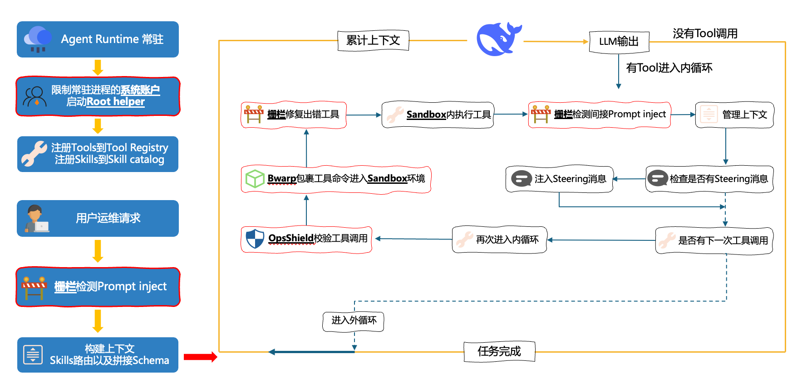

<div align="center">
  
  <h1>NimbusOps</h1>
  <p><strong>安全、可验证的智能运维 Agent</strong></p>
  <p>面向主机与 Kubernetes 故障场景的诊断、处置与评测平台。</p>
</div>

<p align="center">
  <a href="#核心能力">核心能力</a> ·
  <a href="#系统架构">系统架构</a> ·
  <a href="#快速开始">快速开始</a> ·
  <a href="#产品演示">产品演示</a>
</p>

---

## 项目概览

NimbusOps 将运维 Agent 运行时、操作安全控制与可重复评测组合在同一工程中。它提供 WebUI 和服务端运行时，并通过真实 Kubernetes 与主机故障场景验证诊断过程、工具调用及处置结果。

## 核心能力

| 能力 | 说明 |
| --- | --- |
| 智能诊断 | 基于工具调用、日志、指标与上下文完成故障定位和影响分析。 |
| 安全执行 | 通过 AgentSpec 规则、操作确认与受保护目标约束高风险行为。 |
| MCP 集成 | 支持面向运维工具和服务的 MCP 连接、调用轨迹与配置管理。 |
| 可视化交互 | 提供 WebUI，用于会话、任务进度、工具活动和运行状态查看。 |
| 可验证评测 | 提供主机与 Kubernetes 基准环境，覆盖故障注入、结果评分与报告输出。 |

## 系统架构

<p align="center">
  
</p>

## 仓库结构

| 目录 | 内容 |
| --- | --- |
| [`nimbusops-agent`](./nimbusops-agent) | 主服务源码：Agent 运行时、安全策略、MCP 集成与 React WebUI。 |
| [`K8S Bench`](./K8S%20Bench) | 基于 AIOpsLab 的 Kubernetes 故障现场生成与评测工作流。 |
| [`HostOpsBench`](./HostOpsBench) | 主机运维基准框架：故障注入、轨迹记录、评分与报告。 |

## 快速开始

### 环境要求

- Python 3.11 或 3.12
- Node.js 与 npm（WebUI 开发时需要）

### 启动服务

```bash
cd nimbusops-agent
python -m venv .venv
source .venv/bin/activate
python -m pip install --upgrade pip
python -m pip install -e .

nimbusops init-config
nimbusops serve
```

服务默认地址：`http://127.0.0.1:18790`

### 启动 WebUI 开发环境

```bash
cd nimbusops-agent/webui
npm ci
npm run dev
```

WebUI 默认地址：`http://127.0.0.1:5173`

## 测试与评测

- [Kubernetes 评测工作流](./K8S%20Bench/README.md)：部署微服务、注入真实故障、启动负载并执行评测。
- [主机运维基准](./HostOpsBench/README.md)：覆盖 IO 高负载、日志洪泛、CPU 饱和、文件描述符泄漏、上游 HTTP 故障与 systemd 配置错误等场景。

## 产品演示

https://github.com/user-attachments/assets/70a5da70-d36d-42d0-9c52-24e92a4fecb3
