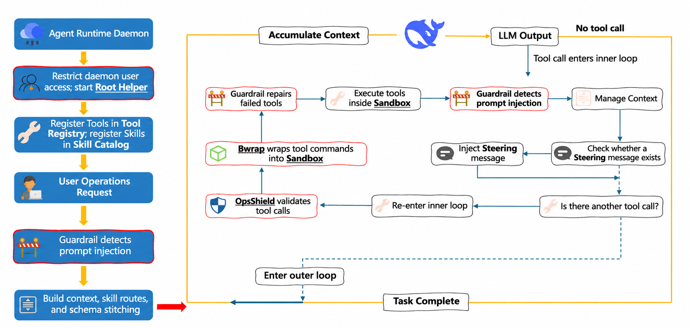

<div align="center">
  
  <h1>NimbusOps</h1>
  <p><strong>A secure, verifiable AI agent for operations</strong></p>
  <p>A platform for diagnosing, remediating, and evaluating failures across hosts and Kubernetes environments.</p>
</div>

<p align="center">
  <a href="#key-capabilities">Capabilities</a> ·
  <a href="#architecture">Architecture</a> ·
  <a href="#quick-start">Quick Start</a> ·
  <a href="#product-demo">Demo</a> ·
  <a href="#open-source-acknowledgements">Acknowledgements</a> ·
  <a href="#license">License</a>
</p>

---

## Overview

NimbusOps brings together an operations-agent runtime, execution safeguards, and repeatable evaluation in one project. It provides a WebUI and service runtime, validated against real Kubernetes and host failure scenarios for diagnosis, tool execution, and remediation outcomes.

## Key Capabilities

| Capability | Description |
| --- | --- |
| Intelligent diagnosis | Locates faults and analyzes impact from tool calls, logs, metrics, and context. |
| Guarded execution | Constrains high-risk actions with AgentSpec rules, execution confirmation, and protected-target controls. |
| MCP integration | Supports MCP connections for operations tools and services, with call traces and configuration management. |
| Visual operations | Provides a WebUI for conversations, task progress, tool activity, and runtime status. |
| Verifiable evaluation | Includes host and Kubernetes benchmark environments for fault injection, scoring, and report generation. |

## Architecture

<p align="center">
  
</p>

## Repository Structure

| Directory | Contents |
| --- | --- |
| [`nimbusops-agent`](./nimbusops-agent) | Main service source: agent runtime, safety policies, MCP integration, and React WebUI. |
| [`K8S Bench`](./K8S%20Bench) | Kubernetes fault-scenario generation and evaluation workflow based on AIOpsLab. |
| [`HostOpsBench`](./HostOpsBench) | Host-operations benchmark framework for fault injection, trace collection, scoring, and reports. |

## Quick Start

### Prerequisites

- Python 3.11 or 3.12
- Node.js and npm (for WebUI development)

### Start the Service

```bash
cd nimbusops-agent
python -m venv .venv
source .venv/bin/activate
python -m pip install --upgrade pip
python -m pip install -e .

nimbusops init-config
nimbusops serve
```

The service listens on `http://127.0.0.1:18790` by default.

### Start the WebUI Development Server

```bash
cd nimbusops-agent/webui
npm ci
npm run dev
```

The WebUI development server runs on `http://127.0.0.1:5173` by default.

## Testing and Evaluation

- [Kubernetes evaluation workflow](./K8S%20Bench/README.md): deploys microservices, injects real faults, runs workloads, and performs evaluation.
- [Host operations benchmark](./HostOpsBench/README.md): covers I/O pressure, log flooding, CPU saturation, file-descriptor leaks, upstream HTTP failures, and systemd configuration errors.

## Product Demo

https://github.com/user-attachments/assets/70a5da70-d36d-42d0-9c52-24e92a4fecb3

## Open Source Acknowledgements

NimbusOps is built on open-source work. We thank the original authors and contributors:

- **Agent Runtime**: adapted from the design and selected implementation of [HKUDS/nanobot](https://github.com/HKUDS/nanobot), under the MIT License.
- **Kubernetes evaluation baseline**: adapted from [Microsoft AIOpsLab](https://github.com/microsoft/AIOpsLab), under the MIT License. The original license and NOTICE are retained in [`K8S Bench`](./K8S%20Bench).
- **Action Guardrails**: selected implementation was adapted from [forge-guardrails](https://github.com/antoinezambelli/forge), under the MIT License.

See [THIRD_PARTY_NOTICES.md](./THIRD_PARTY_NOTICES.md) for complete third-party component, copyright, and license information.

## License

NimbusOps original code is released under the [Apache License 2.0](./LICENSE). Third-party components remain subject to their respective licenses and attribution requirements.
